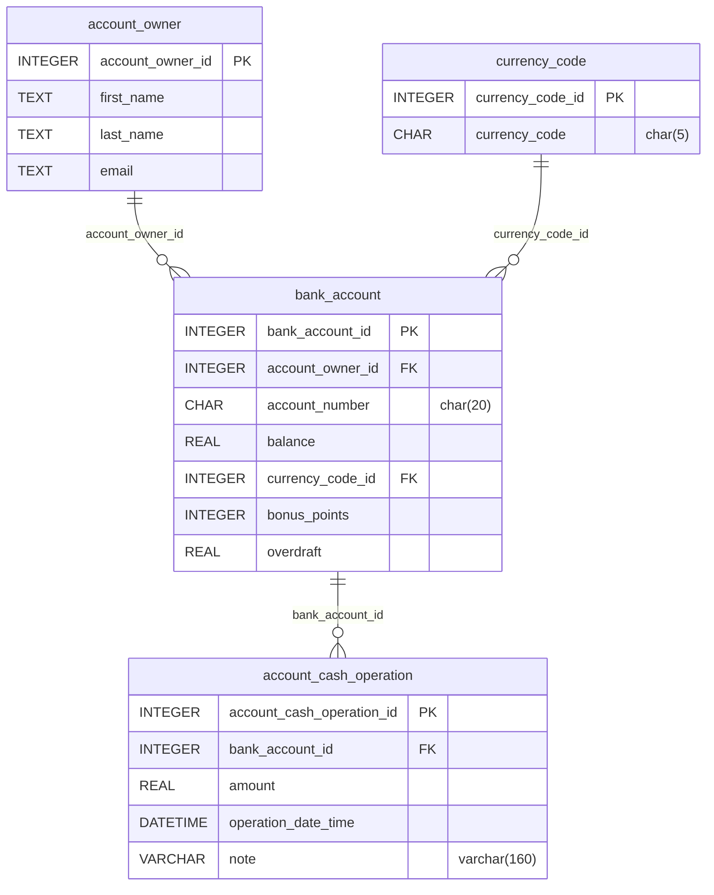
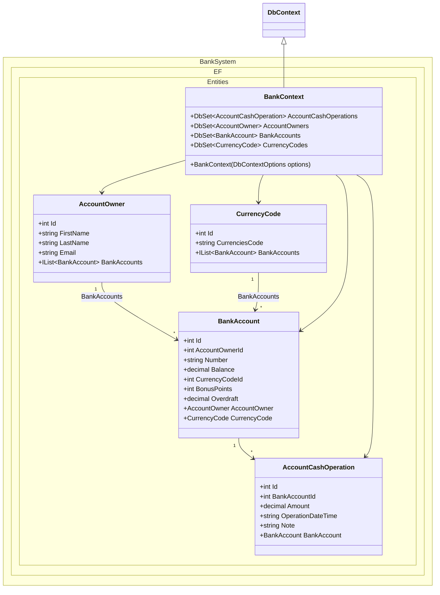

# Bank Account System (Entity Framework Core)

Assessment task that checks Entity Framework model configuration and LINQ-to-SQL query skills.

Estimated time to complete the task - 2h.

The task requires .NET 10 SDK installed.

## Task Description

This task is based on the *BankSystem* database. Map the entities in `BankSystem.EF/Entities` to this schema:

Analyze and study the database diagram before starting the task. The `operation_date_time` column is declared as `DATETIME`, but the entity property `OperationDateTime` is a `string`, as shown in the class diagram below. The `REAL` columns map to `decimal` properties.

Implement the entity classes and `BankContext` in `BankSystem.EF/Entities` as shown below. Declare every property and navigation with the shown name and type, make `BankContext` a `DbContext` with the shown constructor and sets, then map the entities to the schema with data annotations.

Declare only the members shown in the diagram. The tests count the properties, methods and constructors of every entity, so do not add extra members (no `ToString()`, no constructors with parameters, no helper properties or fields). Use auto-properties with `get` and `set`.

### 1. Data Annotations

Configure the [Entity Framework models](https://learn.microsoft.com/en-us/ef/core/#the-model) for the *Bank System* database using the [data annotations](https://learn.microsoft.com/en-us/ef/core/modeling/#use-data-annotations-to-configure-a-model). The entities are the classes in the [Entities](BankSystem.EF/Entities) folder.

* Apply the [TableAttribute](https://learn.microsoft.com/en-us/dotnet/api/system.componentmodel.dataannotations.schema.tableattribute) to all models to specify the database table that a model is mapped to.
* Apply the [ColumnAttribute](https://learn.microsoft.com/en-us/dotnet/api/system.componentmodel.dataannotations.schema.columnattribute) to a model properties to specify a database column that a model property is mapped to.
* Apply the [StringLengthAttribute](https://learn.microsoft.com/en-us/dotnet/api/system.componentmodel.dataannotations.stringlengthattribute) to the string properties that map to a column with a length in the schema: `currency_code` (5), `account_number` (20) and `note` (160). The other string columns have no length.
* Apply the [KeyAttribute](https://learn.microsoft.com/en-us/dotnet/api/system.componentmodel.dataannotations.keyattribute) to a model property that uniquely identifies an entity.
* Apply the [ForeignKeyAttribute](https://learn.microsoft.com/en-us/dotnet/api/system.componentmodel.dataannotations.schema.foreignkeyattribute) to a model property that is used as a foreign key in a relationship.

### 2. Bank models

In this section you have to implement a few models that will be used in the services.

#### 2.1. Account Owner Total Balance Model

Implement the [AccountOwnerTotalBalanceModel](BankSystem.Services/Models/AccountOwnerTotalBalanceModel.cs) class that should contain public auto properties with get/set:
* AccountOwnerId (int);    
* FirstName (string);  
* LastName (string);   
* CurrencyCode (string);
* Total (decimal);

#### 2.2. Bank Account Full Information Model

Implement the [BankAccountFullInfoModel](BankSystem.Services/Models/BankAccountFullInfoModel.cs) class that should contain public auto properties with get/set:
* BankAccountId (int);    
* FirstName (string);  
* LastName (string);   
* AccountNumber (string);
* Balance (decimal);
* CurrencyCode (string);
* BonusPoints (int);

### 3. Bank services

In this section you have to implement few service methods that generate various models.

#### 3.0. Base Service

Both services derive from the [BaseService](BankSystem.Services/Services/BaseService.cs) class, which you also implement:
* It has a public constructor that takes a `BankContext` named `bankContext`. `AccountService` and `OwnerService` have a public constructor with the same single parameter and pass it to the base class.
* It exposes the context to derived classes through a `protected BankContext Context` property.
* It implements `IDisposable`: `Dispose()` disposes the context, may be called more than once, and follows the standard dispose pattern (`protected virtual void Dispose(bool disposing)` and `GC.SuppressFinalize`).

#### 3.1. Account Service

Implement the [GetBankAccountsFullInfo](BankSystem.Services/Services/AccountService.cs) method of the *AccountService* class:
* The method must return `IReadOnlyList<BankAccountFullInfoModel>`.
* Return one row for every bank account, not one row per owner.
* Build the result with LINQ.

#### 3.2. Owner Service

Implement the [GetAccountOwnersTotalBalance](BankSystem.Services/Services/OwnerService.cs) method of the *OwnerService* class:
* The method must return `IReadOnlyList<AccountOwnerTotalBalanceModel>`.
* Build the result with LINQ.
* Group by the owner and the currency. Sum `Balance` as `decimal`. Do not convert the amount through `double`.
* Sort the result by `Total` descending.  
