# Bank Account System (OOAD)

Assessment task that checks object-oriented analysis and design skills.

_Estimated time to complete the task - 4h._

_The task requires .NET 10 SDK installed._

## Task Description

Implement classes that represent a banking system. The public model is:

```mermaid
classDiagram
    class AccountCashOperation {
        +decimal Amount
        +DateTime Date
        +string Note
        +AccountCashOperation(decimal amount, DateTime date, string note)
        +ToString() string
    }

    class AccountOwner {
        +string FirstName
        +string LastName
        +string Email
        +AccountOwner(string firstName, string lastName, string email)
        +Add(BankAccount account)
        +Accounts() IList~BankAccount~
        +ToString() string
    }

    class BankAccount {
        <<abstract>>
        +string Number
        +decimal Balance
        +string CurrencyCode
        +AccountOwner AccountOwner
        +int BonusPoints
        #BankAccount(AccountOwner owner, string currencyCode, IUniqueNumberGenerator uniqueNumberGenerator)
        #BankAccount(AccountOwner owner, string currencyCode, Func~string~ numberGenerator)
        #BankAccount(AccountOwner owner, string currencyCode, IUniqueNumberGenerator uniqueNumberGenerator, decimal initialBalance)
        #BankAccount(AccountOwner owner, string currencyCode, Func~string~ numberGenerator, decimal initialBalance)
        #decimal Overdraft*
        +Deposit(decimal amount, DateTime date, string note)
        +Withdraw(decimal amount, DateTime date, string note)
        +GetAllOperations() IList~AccountCashOperation~
        +ToString() string
        #CalculateDepositRewardPoints(decimal amount) int*
        #CalculateWithdrawRewardPoints(decimal amount) int*
    }

    class StandardAccount {
        +StandardAccount(AccountOwner owner, string currencyCode, IUniqueNumberGenerator uniqueNumberGenerator)
        +StandardAccount(AccountOwner owner, string currencyCode, Func~string~ numberGenerator)
        +StandardAccount(AccountOwner owner, string currencyCode, IUniqueNumberGenerator uniqueNumberGenerator, decimal initialBalance)
        +StandardAccount(AccountOwner owner, string currencyCode, Func~string~ numberGenerator, decimal initialBalance)
    }

    class SilverAccount {
        +SilverAccount(AccountOwner owner, string currencyCode, IUniqueNumberGenerator uniqueNumberGenerator)
        +SilverAccount(AccountOwner owner, string currencyCode, Func~string~ numberGenerator)
        +SilverAccount(AccountOwner owner, string currencyCode, IUniqueNumberGenerator uniqueNumberGenerator, decimal initialBalance)
        +SilverAccount(AccountOwner owner, string currencyCode, Func~string~ numberGenerator, decimal initialBalance)
    }

    class GoldAccount {
        +GoldAccount(AccountOwner owner, string currencyCode, IUniqueNumberGenerator uniqueNumberGenerator)
        +GoldAccount(AccountOwner owner, string currencyCode, Func~string~ numberGenerator)
        +GoldAccount(AccountOwner owner, string currencyCode, IUniqueNumberGenerator uniqueNumberGenerator, decimal initialBalance)
        +GoldAccount(AccountOwner owner, string currencyCode, Func~string~ numberGenerator, decimal initialBalance)
    }

    class IUniqueNumberGenerator {
        <<interface>>
        +Generate() string
    }

    class BasedOnTickUniqueNumberGenerator {
        +BasedOnTickUniqueNumberGenerator(DateTime startingPoint)
        +Generate() string
    }

    class GuidNumberGenerator {
        +Generate() string
    }

    class SimpleGenerator {
        +SimpleGenerator Instance$
        +Generate() string
    }

    BankAccount <|-- StandardAccount
    BankAccount <|-- SilverAccount
    BankAccount <|-- GoldAccount
    AccountOwner "1" --> "*" BankAccount : Accounts
    BankAccount "1" --> "*" AccountCashOperation
    IUniqueNumberGenerator <|.. BasedOnTickUniqueNumberGenerator
    IUniqueNumberGenerator <|.. GuidNumberGenerator
    IUniqueNumberGenerator <|.. SimpleGenerator
```



## Conventions

- Implement every class in the existing file with the same name under `BankSystem.Services`; each file already contains the namespace. The constructors of `StandardAccount`, `SilverAccount` and `GoldAccount` are shown in the diagram; `BankAccount` has the matching `protected` constructors.
- Members marked with `#` in the diagram are `protected`. The constructors of the abstract `BankAccount` are `protected` too. Every other member shown in the diagram is `public`.
- `AccountOwner` throws `ArgumentException` when a name is null, empty or white space, or when the email is not a valid address. The same rules apply when the properties are set.
- `BankAccount` throws `ArgumentNullException` when the owner or the number generator is null, and `ArgumentException` when the currency code is null, empty, white space, or not an existing ISO currency code.

## Classes Description

### 1. AccountCashOperation Class

This class is designed to represent a bank account cash operation. 

#### Properties

The class has three properties:

- `Amount` (`decimal`) property represents the amount of the bank operation.
- `Date` (`DateTime`) property represents the date and time of the bank operation.
- `Note` (`string`) property represents any notes associated with the bank operation.

#### Constructors

The `AccountCashOperation` class provides a single constructor for initializing instances of cash operations on a bank account.

This constructor requires three parameters:
- `amount` (`decimal`) parameter represents the amount the operation will manipulate.
- `date` (`DateTime`) parameter represents the time when the operation is done.
- `note` (`string`) parameter provides additional details about the operation.

#### Methods

- The class overrides the `ToString()` method. Use the invariant culture. When `Amount` is negative, the operation is a debit; otherwise it is a credit, including zero. The text is `{MM/dd/yyyy HH:mm:ss} {Note} : Credited to account {Amount}.` or `{MM/dd/yyyy HH:mm:ss} {Note} : Debited from account {Amount}.` The amount is printed with its sign.

### 2. AccountOwner Class

The `AccountOwner` class is used for representing a bank account owner. 

#### Properties

This class contains the following properties:

- `FirstName` (`string`) property represents account owner's first name.
- `LastName` (`string`) property represents account owner's last name.
- `Email` (`string`) property represents account owner's email address.

#### Constructors

The `AccountOwner` class provides a single public constructor for the initializing of its instances, representing the bank account owner.

This constructor requires three parameters:
- `firstName` (`string`) parameter represents the first name of the account owner.
- `lastName` (`string`) parameter represents the last name of the account owner.
- `email` (`string`) parameter represents the email address of the account owner.

#### Methods

- `ToString()` method returns `{FirstName} {LastName}, {Email}.` (with the trailing dot), for example `John Doe, john.doe@gmail.com.`
- `Add(BankAccount account)` method allows adding a new `BankAccount` instance to the list of accounts owned by the account owner.
- `Accounts()` method returns a list of `BankAccount` instances associated with the bank account owner:

### 3. BankAccount Class

The `BankAccount` class provides a way to work with bank accounts. This is an abstract class, so it cannot be instantiated directly.

#### Properties

This class includes the following properties:

- `Number` (`string`) property represents the bank account number.
- `Balance` (`decimal`) property represents the balance of the account.
- `CurrencyCode` (`string`) property represents the ISO currency code for the account (e.g., "USD", "EUR", "GBP").
- `AccountOwner` (`AccountOwner`) property represents the owner of the bank account.
- `BonusPoints` (`int`) property represents the bonus points associated with the account; its value is updated with each deposit/withdrawal operation.
- `Overdraft` (`decimal`) property is specified in derived classes and determinate the overdraft limit for the account.

#### Constructors

The abstract `BankAccount` class provides four constructors to allow for various initializing of its instances, representing the bank account.

- The _first_ constructor accepts three parameters:
    - `owner` (`AccountOwner`) parameter represents an accountOwner object.
    - `currencyCode` (`string`) parameter represents the ISO currency code.
    - `uniqueNumberGenerator` (`IUniqueNumberGenerator`) parameter represents an object implementing `IUniqueNumberGenerator` interface, which is used for generating string representation of the unique account numbers.
- The _second_ constructor is very similar to the first; instead of taking an object implementing `IUniqueNumberGenerator`, it takes a `Func<string>` delegate named `numberGenerator`, giving the caller the flexibility of providing any function that generates a unique string.
- The _third_ constructor extends the first one by adding an `initialBalance` parameter, a decimal value used as an initial deposit upon creating the account.
- The _fourth_ constructor extends the second one in a similar way, by adding the `initialBalance` parameter.

#### Methods 

The class includes the following methods:

- `GetAllOperations()` method returns all operations performed on the account.
- `Deposit(decimal amount, DateTime date, string note)` adds a positive amount to the balance, records a cash operation with that positive amount, then adds the bonus points calculated from the balance after the deposit. A non-positive amount throws `ArgumentOutOfRangeException`.
- `Withdraw(decimal amount, DateTime date, string note)` subtracts a positive amount when it does not exceed `Balance + Overdraft`, records a cash operation with the negated amount, then adds the bonus points calculated from the balance after the withdrawal. A non-positive amount throws `ArgumentOutOfRangeException`. An amount above `Balance + Overdraft` throws `InvalidOperationException`.
- `ToString()` returns `{Overdraft} {AccountOwner} No:{Number}. Balance: {Balance}{CurrencyCode}.` followed by a line feed (`\n`). `{AccountOwner}` is the owner's `ToString()` result. Use the invariant culture. For example, a `StandardAccount` of `John Doe` with number `1234567890`, currency `USD` and balance `1000` returns `0 John Doe, john.doe@gmail.com. No:1234567890. Balance: 1000USD.\n`.
- `CalculateDepositRewardPoints()` is an abstract method. A subclass specifies how bonus points are calculated upon deposit. The balance used in the formula is the balance after the operation.
- `CalculateWithdrawRewardPoints()` is an abstract method. A subclass specifies how bonus points are calculated upon withdrawal. The balance used in the formula is the balance after the operation.

Every constructor registers the new account in the owner's accounts, so `owner.Accounts()` contains the account right after it is created.

A constructor that accepts `initialBalance` performs that amount as the opening deposit. The new account therefore has one operation, a balance equal to `initialBalance`, and the bonus points for that deposit.

#### Note

Because `BankAccount` is an _abstract_ class, you'll need to create a subclass in order to use most of this functionality. This ensures that the specific details associated with a given bank account type can be handled appropriately.

### 4. StandardAccount Class

`StandardAccount` is a class representing a _standard_ bank account in a banking system. It is _derived_ from the base class `BankAccount`, and it overrides some properties and methods from it.

#### Constants

The `StandardAccount` class declares the following constant that determine the reward point calculation:

- `StandardBalanceCostPerPoint = 100`

#### Constructors

The `StandardAccount` class provides four constructors:
- `StandardAccount(AccountOwner owner, string currencyCode, IUniqueNumberGenerator uniqueNumberGenerator)` initializes a new `StandardAccount` with the specified owner, currency code, and a number generator.
- `StandardAccount(AccountOwner owner, string currencyCode, Func<string> numberGenerator)` initializes a new `StandardAccount` with the specified owner, currency code, and a function that returns the account number.
- `StandardAccount(AccountOwner owner, string currencyCode, IUniqueNumberGenerator uniqueNumberGenerator, decimal initialBalance)` initializes a new `StandardAccount` with the specified owner, currency code, a number generator, and an initial balance.
- `StandardAccount(AccountOwner owner, string currencyCode, Func<string> numberGenerator, decimal initialBalance)` initializes a new `StandardAccount` with the specified owner, currency code, a function that returns the account number, and an initial balance.

#### Properties

The `StandardAccount` class overrides the abstract `Overdraft` property of the base `BankAccount` class:
- `Overdraft`: for the `StandardAccount`, overdraft is always 0.

#### Methods

The `StandardAccount` class overrides two methods of the base `BankAccount` class:
- `CalculateDepositRewardPoints(decimal amount)` method calculates reward points based on _balance_ only, using pre-defined calculation constant according to the formula:

```
DepositRewardPoints = max(floor(Balance / StandardBalanceCostPerPoint), 0)
```
- `CalculateWithdrawRewardPoints(decimal amount)` calculates reward points based on _balance_ only, using the same constant:

```
WithdrawRewardPoints = max(floor(Balance / StandardBalanceCostPerPoint), 0)
```

Here:
- `floor(x)` rounds a number down to the nearest integer;
- `max(x, y)` gives the maximum of `x` and `y`.

### 5. SilverAccount Class

`SilverAccount` is a class representing a _silver_ bank account in a banking system. It is derived from the base class `BankAccount`, and it overrides some properties and methods from it.

#### Constants

The `SilverAccount` class declares the following constants that determine the reward point calculation:

- `SilverDepositCostPerPoint = 5`
- `SilverWithdrawCostPerPoint = 2`
- `SilverBalanceCostPerPoint = 100`

#### Constructors

The `SilverAccount` class provides four constructors:
- `SilverAccount(AccountOwner owner, string currencyCode, IUniqueNumberGenerator uniqueNumberGenerator)` initializes a new `SilverAccount` with the specified owner, currency code, and a number generator.
- `SilverAccount(AccountOwner owner, string currencyCode, Func<string> numberGenerator)` initializes a new `SilverAccount` with the specified owner, currency code, and a function that returns the account number.
- `SilverAccount(AccountOwner owner, string currencyCode, IUniqueNumberGenerator uniqueNumberGenerator, decimal initialBalance)` initializes a new `SilverAccount` with the specified owner, currency code, a number generator, and an initial balance.
- `SilverAccount(AccountOwner owner, string currencyCode, Func<string> numberGenerator, decimal initialBalance)` initializes a new `SilverAccount` with the specified owner, currency code, a function that returns the account number, and an initial balance.

#### Properties

The `SilverAccount` class overrides the abstract `Overdraft` property of the base `BankAccount` class:
- `Overdraft`: for the `SilverAccount`, overdraft is equals to 2 * BonusPoints.

#### Methods

The `SilverAccount` class overrides two methods of the base `BankAccount` class:
- `CalculateDepositRewardPoints(decimal amount)` method calculates reward points based on _balance_ and _deposit_ amount, using pre-defined calculation constants according to the formula:

```
DepositRewardPoints = max(floor((Balance / SilverBalanceCostPerPoint) + (Deposit / SilverDepositCostPerPoint)), 0)
```
- `CalculateWithdrawRewardPoints(decimal amount)` calculates reward points based on _balance_ and the withdrawal amount:

```
WithdrawRewardPoints = max(floor((Balance / SilverBalanceCostPerPoint) + (Withdrawal / SilverWithdrawCostPerPoint)), 0)
```

Here:
- `floor(x)` rounds a number down to the nearest integer;
- `max(x, y)` gives the maximum of `x` and `y`.


### 6. GoldAccount Class

`GoldAccount` is a class representing a _gold_ bank account in a banking system. It is derived from the base class `BankAccount`, and it overrides some properties and methods from it.

#### Constants

The `GoldAccount` class declares the following constants that determine the reward point calculation:

- `GoldDepositCostPerPoint = 10`
- `GoldWithdrawCostPerPoint = 5`
- `GoldBalanceCostPerPoint = 5`

#### Constructors

The `GoldAccount` class provides four constructors:
- `GoldAccount(AccountOwner owner, string currencyCode, IUniqueNumberGenerator uniqueNumberGenerator)` initializes a new `GoldAccount` with the specified owner, currency code, and a number generator.
- `GoldAccount(AccountOwner owner, string currencyCode, Func<string> numberGenerator)` initializes a new `GoldAccount` with the specified owner, currency code, and a function that returns the account number.
- `GoldAccount(AccountOwner owner, string currencyCode, IUniqueNumberGenerator uniqueNumberGenerator, decimal initialBalance)` initializes a new `GoldAccount` with the specified owner, currency code, a number generator, and an initial balance.
- `GoldAccount(AccountOwner owner, string currencyCode, Func<string> numberGenerator, decimal initialBalance)` initializes a new `GoldAccount` with the specified owner, currency code, a function that returns the account number, and an initial balance.

#### Properties

The `GoldAccount` class overrides the `Overdraft` property of the base `BankAccount` class:
- `Overdraft`: for the `GoldAccount`, overdraft is equals to `3 * BonusPoints`.

#### Methods

The `GoldAccount` class overrides two methods of the base `BankAccount` class:
- `CalculateDepositRewardPoints(decimal amount)` method calculates reward points based on _balance_ and _deposit_ amount, using pre-defined calculation constants according to the formula:

```
DepositRewardPoints = max(ceiling((Balance / GoldBalanceCostPerPoint) + (Deposit / GoldDepositCostPerPoint)), 0)
```
- `CalculateWithdrawRewardPoints(decimal amount)` calculates reward points based on _balance_ and the withdrawal amount:

```
WithdrawRewardPoints = max(ceiling((Balance / GoldBalanceCostPerPoint) + (Withdrawal / GoldWithdrawCostPerPoint)), 0)
```

Here:
- `ceiling(x)` rounds a number up to the nearest integer;
- `max(x, y)` gives the maximum of `x` and `y`.

### 7. IUniqueNumberGenerator Interface

The `IUniqueNumberGenerator` interface outlines a contract for classes that aim to generate unique strings, used for unique identification bank account numbers.

#### Method
- `Generate()` method, when implemented, must generate a string that represents a unique number.

### 8. GuidNumberGenerator Class

#### Method
- `Generate()` method provides a concrete implementation for the `IUniqueNumberGenerator` interface. This class generates a unique string based on a globally unique identifier (GUID)  with the help of the `CryptoHelper` class.

### 9. BasedOnTickUniqueNumberGenerator Class

#### Properties
- `startingPoint` (`DateTime`) property represents the initial point in time from which the elapsed time is calculated.

#### Constructors
The `BasedOnTickUniqueNumberGenerator` class has a single public constructor which initializes a new instance of this class. The constructor takes one parameter:
- `startingPoint` (`DateTime`) parameter represents the starting point in time from which the ticks (time) would be counted.

#### Method
- `Generate()` implements `IUniqueNumberGenerator`. It calculates the elapsed ticks from the `startingPoint` to the current time, hashes this value with `CryptoHelper.GenerateHash`, and returns the hash.

### 10. SimpleGenerator Class
The `SimpleGenerator` class serves as a simple unique number generator that generates sequential numbers. This class implements the `IUniqueNumberGenerator` interface and adheres to the _Singleton_ design pattern. It remembers the last number it issued. The sequence starts at 1234567890.

#### Properties
- `Instance` property represents single instance of `SimpleGenerator`. This is a read-only property that gets created and initialized during the first call to the `Instance`.

#### Constructors
The `SimpleGenerator` class has two constructor without parameters:
- `SimpleGenerator()` is a private instance constructor, as per the _Singleton_ design pattern.
- `Static SimpleGenerator()` initializes `Instance` property.

#### Method
- `Generate()` method increments the counter and returns the hash of the new value. The counter starts at `1234567890`, so the first call hashes `1234567891`, the second `1234567892`, and so on. The number is hashed with `CryptoHelper.GenerateHash` and returned as a string.

### 11. ValidationService Class

The `ValidationService` class is a static helper class that provides methods for validation. It supports validation of currencies and emails.

#### Methods

- `IsCurrencyValid` extension method checks if the specified currency is valid. It makes use of the `CultureInfo` and `RegionInfo` classes to match the currency against a list of known currencies.
- `IsEmailValid` extension method verifies that a specified email is in a correct format.

### 12. CryptoHelper Class

The `CryptoHelper` class is already implemented. It is a static helper that hashes a string for the number generators.

#### Method

- `GenerateHash(string input)` hashes the UTF-8 bytes of the input with SHA-256, keeps the first 16 bytes, and returns them as 32 lowercase hexadecimal characters. A null or empty input throws `ArgumentNullException`.
